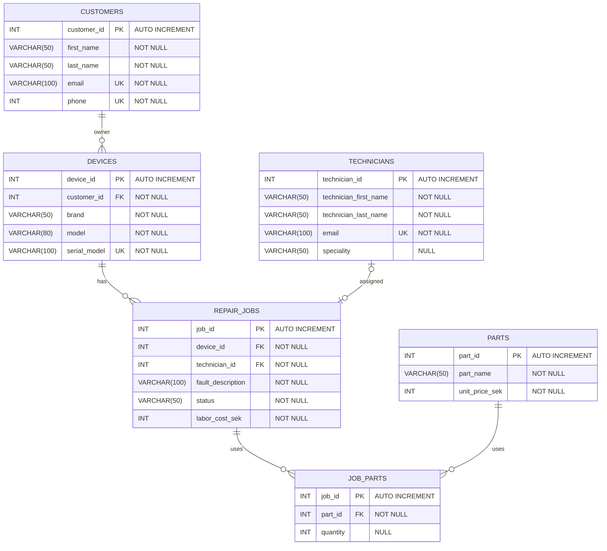

## 1NF

Kontrollera att alla tabeller har en primärnyckel som identifierar varje rad unikt.
Kontrollera att varje cell innehåller ett enskilt värde.
Kontrollera att inga listor eller upprepade grupper finns i en kolumn.

FixPoint

inga dubletter inom tabeller och informationen är lagrad enligt 1NF
alla tabeller har en primär nyckel
inga listor eller upprepade grupper i en kolumn

## 2NF

tabellerna ska först uppfylla 1NF och varje kolumn som inte ingår i primärnyckeln ska bero på hela primärnyckeln, inte bara en del av den

FixPoint

job_parts_raw
part_name beror endast på nyckeln part_id (i vilket namnet också redan kan letas upp) och inte den sammansatta primärnyckeln job_id och part_id, så part_name bör tas bort

quantity däremot beror på både job_id och part_id och stämmer överens med 2NF.

## 3NF

Kollar noggrannare på information som inte är primärnycklar så att de inte beror på information som INTE är primärnycklar heller. Det ska INTE finnas några indirekta beroenden. Primärnycklar är THE KEY.

Fixpoint

flytta labor_cost
detta är inget som vi kanske bör göra nu under uppgiften men i teorin något som kanske ges som feedback till kunden. Om labor_cost flyttas till en tabell där man kopplar pris på parts, quantities, och job_id så får man en tydligare och enklare överblick på ens finanser
i dagsläget är repair_jobs en stor tabell med mycket information och det kan ge en tydligare överblick
men detta är nog mer en databasdesigns förbättring och inte normalisering
repair_jobs_raw
ta bort device_brand då device_id redan är kopplat - samma anledning som ovan
fault_description relaterar till repair_jobs så den är bra! samma som status

## PK

## FK

## UK

## NULL

## VARCHAR()

