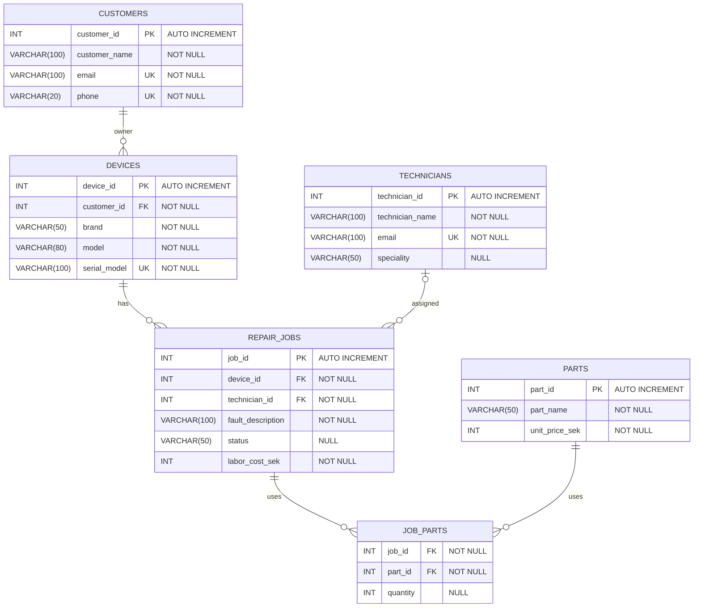

## JOB_PARTS:

Uses `part_id` and `job_id` as a combined primary key to work as a junction table.
M:M relation, several parts for several repair jobs.

## REPAIR_JOBS:

Removed `customer_name` since it already exists in `CUSTOMERS`
`device_brand` is removed because it already exists in `device_id`
Quantity is `NULL`, part quantity can be 0.

## CUSTOMER:

Tried adding first och last name but decided to use `customer_name` for now. Can be discussed with the company.
Removed city-column with the reasoning that it is unnecessary, should probably be discussed with the company.
`phone` and `email` is `UNIQUE` to be different for every customer.
1:M relation, one customer can have several devices.

## TECHNICIANS:

Tried adding first och last name but decided to use `customer_name` for now. Can be discussed with the company.
1:M relation, one technician can have multiple `repair_jobs`.
Email is `UNIQUE`.
Specialty is `NULL`, a technician doesn’t need a specialty.

## DEVICES:

serial_model is `UNIQUE`.
1:M Relation, one device can have several repair jobs.

