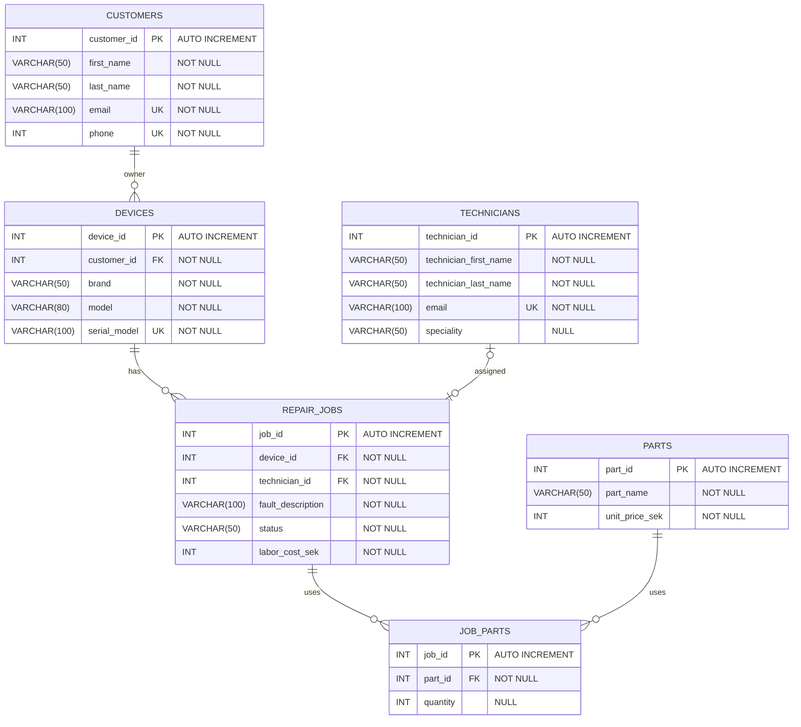

```
Data removed and reasoning:

- JOB_PARTS
    -> Part_nam, Only relates to part ID and FYLL P{ SEN}

- REPAIR_JOBS
    -> removed costumer_name, cuz costrumer_name exisrs in relashion in YES FYLL P{ SEN}
    ->  device_brand is removved cuz it already exists in device_id

- CUSTOMERS
    -> city removed
```

```
Data added and reasoning:

- From name to
    -> first_name
    -> last_name

```


